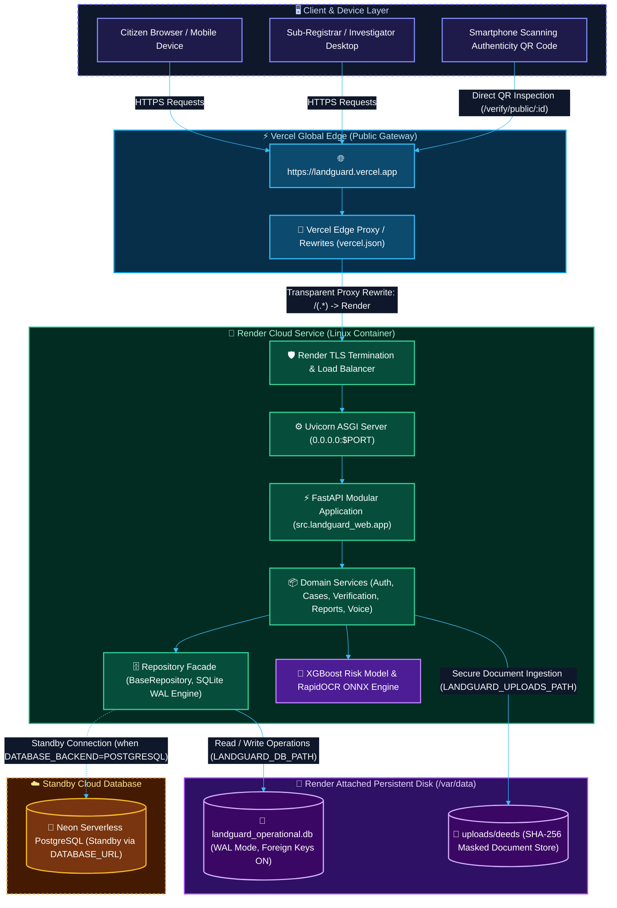
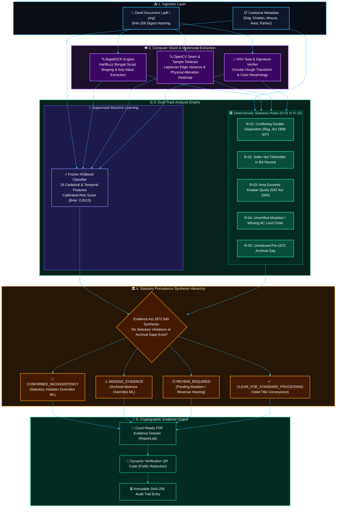
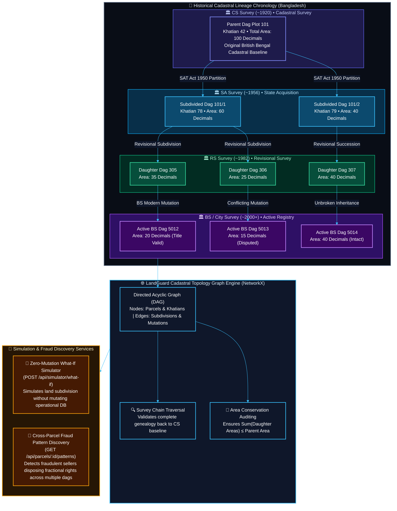
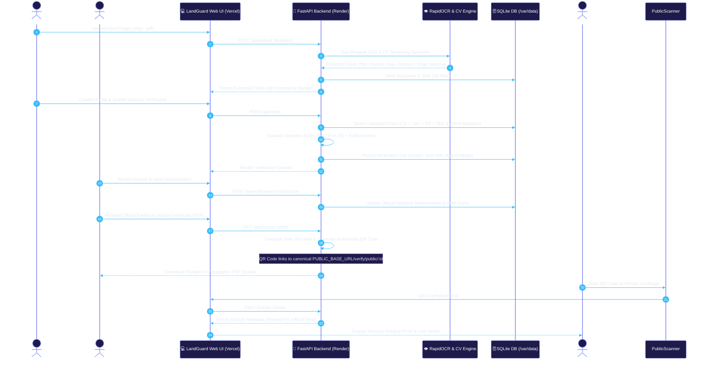
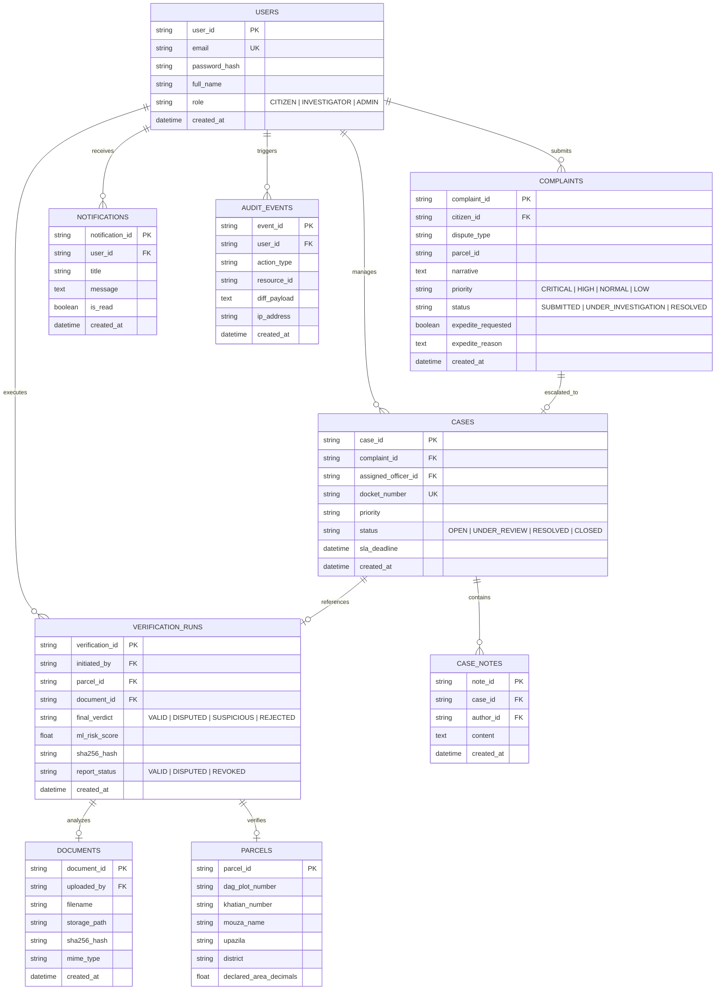

<div align="center">

# 🛡️ LandGuard AI
### Statutory Land Record Verification & Title Defense Platform

**LandTech 2026 P3 Track: Fraud & Double-Selling Detection**  
*Autonomous Cadastral Chain Reconstruction (CS ➔ SA ➔ RS ➔ BS) • Bilingual OCR & Tampering Detection • Explainable Risk Scoring • Cryptographic QR Evidence Dossiers*

<br>

[](https://python.org)
[](https://fastapi.tiangolo.com)
[](https://xgboost.ai)
[](https://github.com/RapidAI/RapidOCR)
[](https://sqlite.org)
[](https://neon.tech)
[-brightgreen?style=for-the-badge&logo=pytest&logoColor=white)](tests/)
[](https://render.com)
[](https://vercel.com)
[-E91E63?style=for-the-badge)](src/landguard_web/localization.py)

<br>


<br>

| 🌐 **Public Live URL** | ⚙️ **Backend Service** | 🗄️ **Primary Database** | 🛡️ **Test Coverage** |
| :---: | :---: | :---: | :---: |
| [landguard.vercel.app](https://landguard.vercel.app) | **Render Linux Container** (`FastAPI + Uvicorn`) | **SQLite WAL** (`/var/data/landguard_operational.db`) | **277 / 277 Passing (100%)** |

</div>

---

## 📑 Table of Contents

- [1. Executive Summary & Purpose](#1-executive-summary--purpose)
- [2. Key Capabilities & Statutory Vectors](#2-key-capabilities--statutory-vectors)
- [3. System Architecture](#3-system-architecture)
- [4. Multimodal AI & Statutory Rules Decision Pipeline](#4-multimodal-ai--statutory-rules-decision-pipeline)
- [5. Cadastral Survey Chain Lineage & Graph Topology Engine](#5-cadastral-survey-chain-lineage--graph-topology-engine)
- [6. End-to-End Verification & QR Journey](#6-end-to-end-verification--qr-journey)
- [7. Database Entity-Relationship Model](#7-database-entity-relationship-model)
- [8. Technology Stack](#8-technology-stack)
- [9. Repository Structure](#9-repository-structure)
- [10. Demonstration Accounts & Evaluation Flow](#10-demonstration-accounts--evaluation-flow)
- [11. Local Setup & Quickstart](#11-local-setup--quickstart)
- [12. Automated Testing & Verification](#12-automated-testing--verification)
- [13. Environment Configuration](#13-environment-configuration)
- [14. Cloud Deployment (Render + Vercel)](#14-cloud-deployment-render--vercel)
- [15. Statutory Disclaimers](#15-statutory-disclaimers)

---

## 1. Executive Summary & Purpose

**LandGuard** is an AI-assisted, statutory evidence-driven land record verification, cadastral topology reconstruction, and complaint investigation platform built for Bangladesh's **LandTech 2026 P3 Track**.

The platform is purpose-engineered to mitigate the four principal vectors of deed manipulation in Bangladesh land administration:

1. ⚡ **Concurrent Double-Selling & Multiple Conveyances** (*Registration Act 1908, Section 47*): Multiple deed registrations executed across different Sub-Registry offices on the exact same Dag/Plot parcel before mutation indexation.
2. 🏛️ **Registration vs. AC Land Mutation Discrepancies** (*State Acquisition and Tenancy Act 1950, Section 143*): Divergence between registered sale deeds and official AC (Land) Upazila Mutation ledgers.
3. 🔍 **Physical Deed Tampering & Altered Dag Numbers**: Detection of physical paste-overs, razor scrapes, and altered digits via Computer Vision seam analysis and HSV seal texture anomalies.
4. 📜 **Ancestral Title Chain Discrepancies & Archival Gaps**: Complete genealogical and survey succession mapping across **CS (Cadastral Survey)** ➔ **SA (State Acquisition)** ➔ **RS (Revisional Survey)** ➔ **BS (Bangladesh Survey)**.

### ⚖️ Non-Negotiable Evidence Hierarchy

$$\Large \text{Deterministic Statutory Predicates} \succ \text{Human Review / Clarification} \succ \text{Supplementary Calibrated ML Risk}$$

> **Evidence Act 1872 Section 45 Adherence**: Machine learning risk scores and computer vision edge heatmaps serve strictly as supplementary decision-support evidence for authorized investigators; they never automatically override statutory deeds or administrative title deeds.

---

## 2. Key Capabilities & Statutory Vectors

<table>
  <tr>
    <td width="50%">
      <h3>🏛️ Dual-Portal Role Architecture</h3>
      <ul>
        <li><strong>Citizen Portal</strong>: Upload deeds, track verification status, submit land disputes, request expedited reviews, and manage digital land identity.</li>
        <li><strong>Investigator Command Center</strong>: Bento-grid analytics, real-time alerts, priority docket queues, official case notes, and SLA tracking.</li>
      </ul>
    </td>
    <td width="50%">
      <h3>🧠 Calibrated AI Risk Engine</h3>
      <ul>
        <li><strong>19 Domain Features</strong>: Extracted from chain depth, party continuity, temporal gaps, and mutation records.</li>
        <li><strong>XGBoost 3.x Classifier</strong>: Trained on 2,500 scenarios with probability calibration (Brier score 0.0013) and SHAP feature attribution.</li>
      </ul>
    </td>
  </tr>
  <tr>
    <td width="50%">
      <h3>👁️ Vision & Tamper Detection</h3>
      <ul>
        <li><strong>RapidOCR Engine</strong>: Bilingual text extraction supporting Bengali unicode with complex conjuncts (যুক্তাক্ষর).</li>
        <li><strong>Physical Seam Detector</strong>: Edge-discontinuity, adhesive artifact identification, and official ink seal HSV analysis.</li>
      </ul>
    </td>
    <td width="50%">
      <h3>🎙️ Voice Assistant ("Hello Daffodil")</h3>
      <ul>
        <li><strong>Site-Wide Voice Control</strong>: Hands-free navigation and action execution across both English and Bengali.</li>
        <li><strong>Voice Actions</strong>: "Show Dashboard", "Verify Deed", "Open Complaints", "Check Plot 9044".</li>
      </ul>
    </td>
  </tr>
  <tr>
    <td width="50%">
      <h3>🌐 100% Bilingual Localization</h3>
      <ul>
        <li><strong>Instant Language Toggle</strong>: Seamless switching between <strong>বাংলা</strong> and <strong>English</strong>.</li>
        <li><strong>Jinja2 i18n Integration</strong>: Centralized dictionaries with persistent cookie and database preference storage.</li>
      </ul>
    </td>
    <td width="50%">
      <h3>🔏 Cryptographic PDF Evidence Dossier</h3>
      <ul>
        <li><strong>ReportLab Generator</strong>: Official court-ready PDF dossier with embedded SHA-256 integrity hash.</li>
        <li><strong>Public QR Verification</strong>: Scannable QR code directing to live public certificate (<code>/verify/public/:id</code>).</li>
      </ul>
    </td>
  </tr>
</table>

---

## 3. System Architecture

LandGuard utilizes a hybrid cloud architecture combining **Render's persistent backend compute** with **Vercel's global edge network**.



### 🔒 Architectural Guarantees

- **Unified Domain Experience**: The entire application, static assets, login sessions, and forms are exposed seamlessly under the public Vercel domain (`https://landguard.vercel.app`).
- **Complete Data Persistence**: Render mounts an attached persistent SSD disk at `/var/data`. The operational SQLite database (`/var/data/landguard_operational.db`) survives service restarts, deployments, and rebuilds.
- **Zero-Overwrite Deployment Guard**: The initialization guard (`scripts/init_persistent_db.py`) automatically seeds the persistent disk on first boot, and strictly skips re-initialization on subsequent deployments, preserving all live user data and complaints.

---

## 4. Multimodal AI & Statutory Rules Decision Pipeline

The deed verification engine runs a dual-track multimodal inspection combining deterministic statutory predicates (Registration Act 1908, SAT Act 1950) with supplementary machine learning risk scoring:



---

## 5. Cadastral Survey Chain Lineage & Graph Topology Engine

LandGuard models Bangladesh's multi-generational land records as a Directed Acyclic Graph (DAG) across the four canonical survey epochs:



---

## 6. End-to-End Verification & QR Journey



---

## 7. Database Entity-Relationship Model

The operational database maintains strict foreign-key constraints and relational integrity across all domain entities:



---

## 8. Technology Stack

| Layer | Component | Technology & Specification |
| :--- | :--- | :--- |
| **Edge Routing & Proxy** | Vercel Edge Network | Transparent reverse-proxy rewrites via `vercel.json` |
| **Backend Application** | FastAPI 0.110+ | Asynchronous ASGI RESTful API & Server-Side Rendered (SSR) routes |
| **ASGI Web Server** | Uvicorn 0.28+ | High-performance ASGI server with forwarded headers enabled |
| **Templating & UI** | Jinja2 3.1+ & TailwindCSS | Bento-grid responsive layout with bilingual i18n support |
| **Primary Operational DB** | SQLite 3 (WAL Mode) | Persistent transactional disk storage on Render persistent disk (`/var/data`) |
| **Standby Cloud DB** | Neon Serverless PostgreSQL | Serverless PostgreSQL driver (`psycopg2-binary`) on standby |
| **Machine Learning** | XGBoost 3.x & Scikit-learn | 19 domain features, calibrated risk score, Brier score 0.0013 |
| **Vision & OCR** | RapidOCR, OpenCV, PyMuPDF | Text line detection, HarfBuzz Bengali shaping, seam artifact analysis |
| **Cryptographic Reports** | ReportLab & Qrcode | Court-ready PDF dossiers with embedded SHA-256 hash & dynamic QR links |
| **Cadastral Maps** | Leaflet.js & GeoJSON | Interactive cadastral topology and plot boundary visualizations |

---

## 9. Repository Structure

```
.
├── render.yaml                          # Render cloud service & persistent disk blueprint
├── vercel.json                          # Vercel domain reverse-proxy configuration
├── requirements.txt                     # Production Python dependencies (Linux/Render ready)
├── pyproject.toml                       # Python package specification and pytest configuration
├── .env.example                         # Environment configuration template with safe placeholders
├── .gitignore                           # Git ignore specification protecting operational databases
├── README.md                            # Comprehensive system documentation & deployment guide
├── TESTS.md                             # Automated test suite specification & coverage metrics
├── landguard_preloader_animated.svg     # Animated cyber radar & statutory verification SVG
├── landguard_preloader_animated.gif     # High-definition animated preview asset
├── docs/                                # Technical system specifications & architectural blueprints
│   ├── ARCHITECTURE.md                  # Comprehensive architecture & system design document
│   └── landguard_preloader_animated.svg # Vector assets and design references
├── scripts/
│   ├── init_persistent_db.py           # Idempotent persistent volume initialization & seeding guard
│   ├── generate_all_markdown_and_pdfs.py # Batch dossier generation utility
│   ├── generate_favicon.py             # Favicon asset generator
│   └── test_selenium_hands_free.py     # End-to-end automated browser test script
├── data/
│   ├── landguard_operational.db         # Canonical seed database (399 complaints, 120 cases)
│   ├── fixtures/demo_manifest.json     # Demonstration parcel and scenario fixtures
│   ├── manifests/dataset_manifest.json  # Comprehensive dataset metadata
│   └── targeted_expansion/             # High-resolution benchmark deed images and annotations
├── models/
│   ├── xgboost_risk_model.joblib        # Pre-trained frozen XGBoost title risk classifier
│   └── model_metadata.json              # Model hyperparameters, feature names, and ROC metrics
├── src/
│   ├── landguard_ai/                    # Multi-modal grievance claim extraction & grounding
│   ├── landguard_data/                  # Database connections and domain repositories
│   │   ├── database.py                  # Primary database manager and repository facade
│   │   └── repositories/               # Specialized repositories (Cases, Complaints, Users, etc.)
│   ├── landguard_models/                # Feature engineering, XGBoost, and statutory rules
│   │   ├── verification_rules.py        # Statutory rules engine (R-01 through R-10)
│   │   └── explainable_risk.py          # SHAP/Tree-based feature importance breakdown
│   ├── landguard_vision/                # Bilingual OCR and computer vision seam analysis
│   ├── landguard_reports/               # Tamper-evident PDF and QR code generators
│   ├── landguard_services/              # Domain business logic services (Auth, Complaints, Cases)
│   └── landguard_web/                   # FastAPI application presentation layer
│       ├── app.py                       # Main ASGI application entry point
│       ├── dependencies.py              # Authentication dependencies and RBAC guards
│       ├── localization.py              # Bilingual localization engine (English / বাংলা)
│       ├── rate_limiter.py              # In-memory sliding-window request throttling
│       ├── routers/                     # Domain-specific route controllers
│       ├── static/                      # Static CSS, JavaScript, and branding assets
│       └── templates/                   # Jinja2 templates (Public, Citizen, Admin portals)
└── tests/                               # Comprehensive automated test suite (277 passing tests)
    ├── conftest.py                      # Test database isolation fixture (protects operational DB)
    ├── test_web_app.py                  # Core web application and endpoint tests
    ├── test_localization.py             # Bilingual UI and PDF rendering tests
    ├── test_security_authorization.py   # RBAC and IDOR security verification
    └── test_sqlite_persistence.py       # Persistence and volume restart tests
```

---

## 10. Demonstration Accounts & Evaluation Flow

For rapid evaluation and judging, three pre-configured demonstration accounts are available with one-click access on the login screen (`/login`):

| Role | Email | Password | Primary Demonstration Capabilities |
| :--- | :--- | :--- | :--- |
| **Citizen / Landholder** | `citizen@landguard.gov.bd` | `Citizen@123` | Upload deeds, inspect cadastral records, file formal complaints, request expedited review, switch English/বাংলা. |
| **Land Investigator** | `investigator@landguard.gov.bd` | `Investigator@123` | Inspect rule violations, evaluate CV seam anomalies, review timeline evidence, draft official investigation findings. |
| **Sub-Registrar (Admin)** | `admin@landguard.gov.bd` | `Admin@123` | Full statutory governance, approve expedited reviews, issue determination decisions, download cryptographic PDF dossiers. |

### ⏱️ Recommended 5-Minute Evaluation Flow:

1. **Landing & Identity**: Navigate to `/` to view the animated national map and mission brief. Click **Citizen Portal** or **Login** to enter.
2. **Citizen Deed Verification**: In `/user/verify`, upload a sample deed from `data/targeted_expansion/images/IMG-EXP-0001.png`. Review the automated OCR field extraction and submit for statutory verification.
3. **Dispute Filing & Expedited Review**: In `/user/complaints/new`, submit a land grievance and check **Request Expedited Review** with statutory urgency grounds.
4. **Admin Docket & Expedited Approval**: Log out and log in as **Admin**. On `/admin/dashboard`, review the incoming expedited queue and approve the request with one click.
5. **Official Evidence Dossier & QR Code**: In `/admin/verifications`, open the verified dossier, click **Download Dossier (PDF)**, and scan the printed QR code with a smartphone camera to inspect the live public verification certificate (`/verify/public/:id`).

---

## 11. Local Setup & Quickstart

### Prerequisites
- **Python 3.10+** (Python 3.11 recommended)
- **Git**

### Installation

```bash
# 1. Clone repository
git clone https://github.com/ashik123-a1/Land-Gurd.git
cd Land-Gurd

# 2. Create and activate virtual environment
python -m venv .venv

# On Windows (PowerShell):
.venv\Scripts\Activate.ps1
# On Linux / macOS:
source .venv/bin/activate

# 3. Install dependencies
pip install -r requirements.txt

# 4. Copy environment specification
cp .env.example .env

# 5. Initialize operational database
python scripts/init_persistent_db.py

# 6. Launch development server
uvicorn src.landguard_web.app:app --host 127.0.0.1 --port 8000 --reload
```

Open [http://127.0.0.1:8000](http://127.0.0.1:8000) in your web browser.

---

## 12. Automated Testing & Verification

LandGuard features a **strict database isolation harness** (`tests/conftest.py`). Automated tests never touch or mutate the operational database. Each test session creates a disposable temporary SQLite clone via SQLite's online backup API:

```bash
# Run the complete test suite (277 tests)
pytest -q

# Run specific domain test suites
pytest tests/test_web_app.py tests/test_localization.py
pytest tests/test_security_authorization.py tests/test_security_remediation.py
pytest tests/test_sqlite_persistence.py tests/test_database_isolation.py
```

### ✅ Test Suite Status
- **Total Test Cases**: 277
- **Passing**: 277 (100%)
- **Failing**: 0
- **Execution Time**: ~75 seconds

---

## 13. Environment Configuration

Configure these environment variables in your local `.env` file or in your cloud dashboard:

| Variable | Required | Default Value | Description |
| :--- | :---: | :--- | :--- |
| `ENVIRONMENT` | Yes | `production` | Runtime mode (`production` activates secure cookies and strict headers). |
| `PORT` | Auto | `8000` | Port for ASGI binding (assigned by host). |
| `HOST` | No | `0.0.0.0` | Host interface for network binding. |
| `DATABASE_BACKEND` | Yes | `SQLITE` | Active database engine. Must remain `SQLITE` for primary operations. |
| `LANDGUARD_DB_PATH` | Yes | `/var/data/landguard_operational.db` | Absolute path to SQLite operational database on persistent disk. |
| `LANDGUARD_UPLOADS_PATH`| Yes | `/var/data/uploads` | Directory for ingested deed uploads on persistent disk. |
| `LANDGUARD_BASE_URL` | Yes | `https://landguard.vercel.app` | Canonical public URL used to construct dynamic QR code inspection links. |
| `ALLOWED_ORIGINS` | Yes | `https://landguard.vercel.app,http://localhost:8000` | Authorized CORS origins. |
| `ALLOW_DEMO_LOGIN_IN_PROD` | No | `true` | Enables one-click demo credentials for evaluators. |
| `DATABASE_URL` | No | `postgresql://...` | Standby Neon PostgreSQL connection string. |

---

## 14. Cloud Deployment (Render + Vercel)

### A. Backend Deployment on Render
1. In Render Dashboard, click **New &rarr; Blueprint** and select this repository. Render automatically reads `render.yaml`.
2. A 1 GB persistent SSD disk mounted at `/var/data` is automatically provisioned.
3. Build command: `pip install -r requirements.txt`.
4. Start command: `python scripts/init_persistent_db.py && uvicorn src.landguard_web.app:app --host 0.0.0.0 --port $PORT --proxy-headers --forwarded-allow-ips='*'`.

### B. Frontend Deployment on Vercel
1. In Vercel Dashboard, import this repository.
2. Select framework preset **Other** (no build step needed).
3. Ensure `vercel.json` routes all requests to your active Render service:
   ```json
   {
     "version": 2,
     "name": "landguard-frontend-proxy",
     "rewrites": [
       {
         "source": "/(.*)",
         "destination": "https://<your-render-service>.onrender.com/$1"
       }
     ]
   }
   ```
4. Deploy and verify that the public URL loads seamlessly.

---

## 15. Statutory Disclaimers

> **LEGAL NOTICE**: LandGuard was developed as an advanced scientific benchmark and decision-support prototype for the LandTech 2026 competition.  
> 1. All citizen identities, national ID (NID) numbers, mouza cadastral records, and deed parchment images are synthetically generated for benchmark evaluation.  
> 2. Pursuant to the **Registration Act 1908**, **State Acquisition and Tenancy Act 1950**, and **Evidence Act 1872**, algorithmic outputs constitute rebuttable decision-support evidence and do not replace physical title investigation by authorized land registry officials or judicial decree.

---

<div align="center">
  <sub>LandGuard AI • LandTech 2026 P3 Fraud & Double-Selling Track • Developed with ❤️ for Land Administration Modernization in Bangladesh</sub>
</div>
