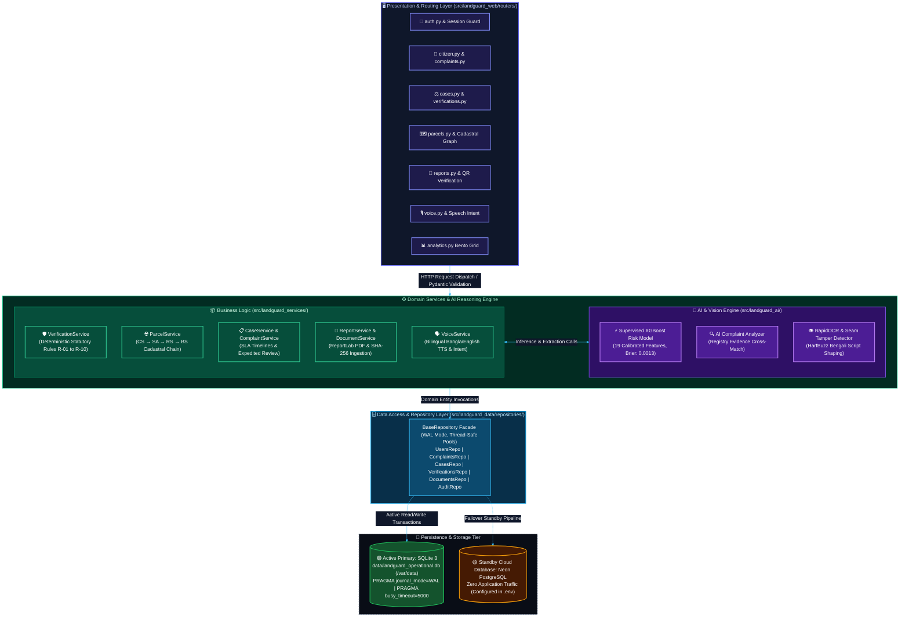

# LandGuard Architecture & System Design Document

**Document Version:** 2.4.0  
**Status:** ACCEPTED & PRODUCTION VERIFIED  
**Primary Operational Database:** SQLite (`data/landguard_operational.db`) — WAL Mode (`PRAGMA journal_mode=WAL`, `PRAGMA busy_timeout=5000`)  
**Standby Database:** Neon Serverless PostgreSQL (Configured in `.env` on Standby, Zero Application Traffic)  
**Total Automated Tests:** 277 / 277 PASSED (0 Warnings, 100% Pass Rate in ~74.7s)  

---

## 1. System Overview & Philosophy

LandGuard is an AI-assisted, evidence-driven statutory land-record verification, cadastral topology reconstruction, and complaint-investigation platform developed for the Bangladesh land administration context (LandTech 2026 P3 Track).

### Non-Negotiable Decision Hierarchy
$$\text{Deterministic Statutory Predicates} \succ \text{Human Review / Clarification} \succ \text{Supplementary Calibrated ML Risk}$$
No machine learning score or computer-vision seam detection can legally establish title ownership or substitute for registrar determination under Bangladesh law (Registration Act 1908, State Acquisition and Tenancy Act 1950, Land Reform Ordinance 1984).

---

## 2. Layered Architecture

The application is structured into four decoupled, resilient architectural tiers:



### 2.1 Presentation & Routing (`src/landguard_web/routers/`)
- `auth.py`: Landing, login, demo-login, session verification, logout.
- `citizen.py`: Citizen dashboard, digital identity card, profile, notification feed.
- `complaints.py`: Citizen dispute filing, status progression, expedite requests.
- `cases.py`: Investigator dockets, status transitions, officer notes, citizen clarifications.
- `verifications.py`: 4-step verify wizard, dossier inspection, official registrar determinations.
- `parcels.py`: Cadastral explorer, survey chain traversal, graph topology, what-if simulator, cross-parcel patterns.
- `reports.py`: Official evidence dossier certificates, PDF generation, dynamic QR, public masking, lifecycle state.
- `documents.py`: Document ingestion, SHA-256 storage, bilingual OCR extraction, file retrieval.
- `voice.py`: Bilingual Bangla & English voice assistant console and speech intent parsing.
- `analytics.py`: Admin command center, 12-month Bento metrics, health check, audit trails.
- `dependencies.py`: Session resolution and role guards (`require_citizen_access`, `require_admin_access`, `require_api_authenticated_user`, `require_api_admin_access`).
- `schemas.py`: Typed Pydantic v2 request schemas.
- `app.py`: Clean 107-line FastAPI application entrypoint.

### 2.2 Domain Services (`src/landguard_services/`) & AI Layer (`src/landguard_ai/`)
- `verification_service.py`: Evaluates deterministic statutory rules (`RULE_AREA_EXCEEDS_CAPACITY`, `RULE_SELLER_NOT_TITLEHOLDER`, `RULE_UNVERIFIED_MUTATION`, `RULE_CONFLICTING_DOUBLE_DISPOSITION`, `RULE_UNINDEXED_PRE1972_ARCHIVE`, `RULE_PHYSICAL_TAMPERING_DETECTED`), runs frozen XGBoost inference, and executes OpenCV seal/signature detection.
- `parcel_service.py`: Navigates cadastral survey chains (CS ~1920 &rarr; SA ~1956 &rarr; RS ~1982 &rarr; BS ~2000+), builds graph nodes and edges, executes zero-mutation what-if simulations, and detects cross-parcel multi-holding patterns.
- `report_service.py`: Generates official ReportLab binary PDF dossiers, dynamic verification QR codes, and masks sensitive citizen PII for public verification.
- `case_service.py`: Docket management, SLA deadline monitoring, overdue case discovery, citizen clarification loops.
- `complaint_service.py`: Dispute filing, timeline tracking, expedited review evaluations, AI analysis triggering.
- `rule_governance_service.py`: Versioned statutory ruleset maintenance, amendment logging, threshold calibration with mandatory justifications.
- `scenario_service.py`: Seeded reproducible synthetic scenario generator across 15 standard and compound fraud archetypes.
- `document_service.py`: Validates uploads, stores deeds under SHA-256 digests, runs bilingual OCR, detects visual seams, enforces RBAC retention locks.
- `analytics_service.py`: Dashboard KPIs, Bento grid 12-month time-series, citizen digital identity card.
- `auth_service.py`: Password verification (PBKDF2-HMAC), session issuance, demo logins.
- `notification_service.py`: In-app notification feeds and read markers.
- `voice_service.py`: Bilingual Bangla and English neural voice synthesis and speech intent parsing.
- `src/landguard_ai/complaint_analyzer.py`: AI-driven claim extraction, category recommendations, duplicate active grievance discovery, and registry evidence classification (`SUPPORTED_BY_AVAILABLE_RECORDS`, `CONTRADICTED_BY_AVAILABLE_RECORDS`, `UNVERIFIED`).

### 2.3 Data Repositories (`src/landguard_data/repositories/`)
- `base.py`: SQLite connection management, WAL mode (`PRAGMA journal_mode=WAL`), `PRAGMA busy_timeout=5000`, 30.0s connection timeout, and credential-safe URI masking.
- `users.py`: User CRUD, role assignments, session tokens with expiration.
- `complaints.py`: Citizen dispute grievances, timeline events, expedite decisions.
- `cases.py`: Investigation cases, docket updates, officer notes.
- `verifications.py`: Verification runs, statutory findings, multi-determination history preservation.
- `documents.py`: Upload metadata, SHA-256 storage paths, mime types.
- `notifications.py`: User notifications and read flags.
- `audit.py`: Immutable audit logging for security and operational transparency.

---

## 3. Reusable UI Components & Macros

All repeating UI elements are consolidated into [`src/landguard_web/templates/components/ui_components.html`](file:///F:/land%20gurd%20main%20project/src/landguard_web/templates/components/ui_components.html) and imported cleanly via Jinja2 (``):

1. `ui.status_badge(val, size="sm")`: High-contrast, theme-consistent badges for verification states, case statuses, and report lifecycle tags.
2. `ui.priority_badge(priority)`: Pulsing dot indicator for `CRITICAL`, amber for `HIGH`, and slate for `NORMAL`/`LOW`.
3. `ui.page_header(title, subtitle, badge, back_url, action_url, action_text)`: Standardized responsive portal headers with optional back links and primary CTA buttons.
4. `ui.synthetic_disclaimer(compact=False)`: Mandatory statutory warning explaining synthetic research data provenance.
5. `ui.kpi_card(title, value, subtitle, icon, accent, trend)`: Dark navy bento KPI metric card with accent borders and icons.
6. `ui.empty_state(title, description, icon, action_url, action_text)`: Standard empty state illustration and CTA for zero-record tables.

**Templates migrated and actively using these components:**
- `admin/cases.html`: Uses `ui.page_header`, `ui.priority_badge`, `ui.status_badge`.
- `admin/verifications.html`: Uses `ui.page_header`, `ui.status_badge`.
- `admin/reports.html`: Uses `ui.page_header`, `ui.synthetic_disclaimer`, `ui.status_badge`.
- `user/complaints.html`: Uses `ui.page_header`, `ui.status_badge`, `ui.empty_state`.
- `user/history.html`: Uses `ui.page_header`, `ui.status_badge`.

---

## 4. Database Source of Truth & Zero-Leakage Policy

1. **SQLite Unconditional Default**: SQLite (`data/landguard_operational.db`) is the active primary operational database handling all reads, writes, sessions, cases, verifications, and audit logging.
2. **Neon Standby Isolation**: Neon PostgreSQL connection strings are kept exclusively in `.env` (`DATABASE_URL`). While `DATABASE_BACKEND=SQLITE` (the unconditional default), zero queries or connections are sent to Neon.
3. **Data Integrity**: Existing SQLite database tables, rows, indexes, and seeded demonstration records remain intact without truncate or drop operations.
4. **Automated Test Database Isolation**: Automated test executions (`pytest`) never mutate the operational database. Using `pytest_configure` in `tests/conftest.py`, an online byte-exact snapshot of `data/landguard_operational.db` is backed up via `src_conn.backup(dst_conn)` into a disposable temporary directory. The application's singleton `service` is rebound to the isolated database, and `BaseRepository._get_connection()` enforces a hard runtime safety guard that immediately raises `RuntimeError` if any test attempts to connect to the operational database in write mode.

---

## 5. Requirements-to-Source-to-Test Matrix

| Feature / Requirement | Domain Source Path | Presentation Route | Test Suite Verification | Actual Status |
| :--- | :--- | :--- | :--- | :--- |
| **Statutory Rules Engine** | `src/landguard_services/verification_service.py` | `POST /api/verify` | `tests/test_verification_rules.py` | `IMPLEMENTED_AND_TESTED` |
| **Supervised XGBoost Risk** | `src/landguard_services/verification_service.py` | `POST /api/verify` | `tests/test_explainable_risk_and_leakage.py` | `IMPLEMENTED_AND_TESTED` |
| **CV Seam / Seal Detector** | `src/landguard_services/document_service.py` | `POST /api/upload` | `tests/test_signature_seal.py` | `IMPLEMENTED_AND_TESTED` |
| **Cadastral Survey Chain** | `src/landguard_services/parcel_service.py` | `GET /api/parcels/{id}` | `tests/test_web_app.py` | `IMPLEMENTED_AND_TESTED` |
| **Topology Graph** | `src/landguard_services/parcel_service.py` | `GET /api/parcels/{id}/graph` | `tests/test_cadastral_graph_and_simulator.py` | `IMPLEMENTED_AND_TESTED` |
| **Zero-Mutation Simulator** | `src/landguard_services/parcel_service.py` | `POST /api/simulator/what-if` | `tests/test_cadastral_graph_and_simulator.py` | `IMPLEMENTED_AND_TESTED` |
| **Cross-Parcel Patterns** | `src/landguard_services/parcel_service.py` | `GET /api/parcels/{id}/patterns`| `tests/test_cadastral_graph_and_simulator.py` | `IMPLEMENTED_AND_TESTED` |
| **Citizen Complaints** | `src/landguard_services/complaint_service.py` | `POST /api/complaints` | `tests/test_sqlite_persistence.py` | `IMPLEMENTED_AND_TESTED` |
| **AI Complaint Analysis** | `src/landguard_ai/complaint_analyzer.py` | `GET /api/complaints/{id}/ai-analysis` | `tests/test_complaint_ai_analysis.py` | `IMPLEMENTED_AND_TESTED` |
| **Expedited Review Workflow**| `src/landguard_services/complaint_service.py` | `POST /api/complaints/{id}/expedite` | `tests/test_expedited_review_lifecycle.py` | `IMPLEMENTED_AND_TESTED` |
| **Case Dockets & Notes** | `src/landguard_services/case_service.py` | `POST /api/cases/{id}/notes` | `tests/test_web_app.py` | `IMPLEMENTED_AND_TESTED` |
| **SLA & Overdue Monitor** | `src/landguard_services/case_service.py` | `GET /api/cases/overdue` | `tests/test_clarification_sla.py` | `IMPLEMENTED_AND_TESTED` |
| **Citizen Clarification Loop**| `src/landguard_services/case_service.py` | `POST /api/cases/{id}/clarification/request` | `tests/test_clarification_sla.py` | `IMPLEMENTED_AND_TESTED` |
| **Bilingual Voice Assistant**| `src/landguard_services/voice_service.py` | `POST /api/voice/parse-intent` | `tests/test_voice_assistant.py` | `IMPLEMENTED_AND_TESTED` |
| **ReportLab Binary PDF** | `src/landguard_services/report_service.py` | `GET /api/reports/pdf/{id}` | `tests/test_reports_integrity.py` | `IMPLEMENTED_AND_TESTED` |
| **Dynamic Verification QR**| `src/landguard_reports/qr_generator.py` | `GET /api/reports/qr/{id}` | `tests/test_reports_integrity.py` | `IMPLEMENTED_AND_TESTED` |
| **Public Masked Verification**| `src/landguard_services/report_service.py` | `GET /verify/public/{id}` | `tests/test_reports_integrity.py` | `IMPLEMENTED_AND_TESTED` |
| **Report Lifecycle State** | `src/landguard_services/report_service.py` | `PATCH /api/reports/{id}/status`| `tests/test_reports_integrity.py` | `IMPLEMENTED_AND_TESTED` |
| **Document SHA-256 Storage**| `src/landguard_services/document_service.py` | `GET /api/documents/{id}/file` | `tests/test_document_storage.py` | `IMPLEMENTED_AND_TESTED` |
| **Document Re-Analysis** | `src/landguard_services/document_service.py` | `POST /api/documents/{id}/reanalyze`| `tests/test_document_storage.py` | `IMPLEMENTED_AND_TESTED` |
| **Immutable Audit Logging**| `src/landguard_data/repositories/audit.py` | `GET /api/audit/trail` | `tests/test_sqlite_primary.py` | `IMPLEMENTED_AND_TESTED` |
| **RBAC / IDOR Protection** | `src/landguard_web/dependencies.py` | All protected endpoints | `tests/test_security_authorization.py` | `IMPLEMENTED_AND_TESTED` |
| **Bengali UI Localization**| `src/landguard_web/localization.py` | `GET /user/*` with `?lang=bn` | `tests/test_localization.py` | `IMPLEMENTED_AND_TESTED` |
| **Test Database Isolation** | `tests/conftest.py` | Runtime safety guard | `tests/test_database_isolation.py` | `IMPLEMENTED_AND_TESTED` |

---

## 6. Execution Commands

```bash
# 1. Run Complete Automated Test Suite under Database Isolation (277 tests)
pytest -q

# 2. Run Focused Test Suites
pytest tests/test_database_isolation.py
pytest tests/test_cadastral_graph_and_simulator.py
pytest tests/test_voice_assistant.py
pytest tests/test_reports_integrity.py

# 3. Launch Development Server
uvicorn src.landguard_web.app:app --host 127.0.0.1 --port 8000
```
