# Phase 0 — Repository Discovery, Dependency Map & Immutable Baseline Audit

## 1. Workspace & Environment Verification
- **Workspace Path**: `F:\land gurd`
- **Git Branch & Baseline Commit**: `master` (`009d7c8` — preserved prior to autonomous improvement mission)
- **Immutable Baseline Snapshot Directory**: [`reports/baseline_snapshot/`](file:///F:/land%20gurd/reports/baseline_snapshot) (contains frozen copies of all pre-mission JSON/CSV metrics, predictions, and evaluation summaries)
- **Runtime Environment**:
  - OS: `Windows 10 (10.0.19045)`
  - Python: `3.11.9` (`C:\Users\ASHIK_CSE\AppData\Local\Programs\Python\Python311\python.exe`)
  - Core Packages: `numpy 2.4.2`, `pandas 3.0.1`, `scikit-learn 1.8.0`, `xgboost 3.2.0`, `Pillow 12.1.1`, `opencv-python 4.13.0.92`, `rapidocr_onnxruntime 1.4.4`, `matplotlib 3.10.8`, `pytest 9.1.1`
  - Default Random Seed: `42` (configured in [`configs/generation.yaml`](file:///F:/land%20gurd/configs/generation.yaml), [`configs/dataset_splits.yaml`](file:///F:/land%20gurd/configs/dataset_splits.yaml), and [`configs/xgboost.yaml`](file:///F:/land%20gurd/configs/xgboost.yaml))

---

## 2. End-to-End Pipeline Dependency Map

```mermaid
flowchart LR
    subgraph S1["1. Synthetic Data Generation"]
        GE["generate_entities.py\n(15k Owners, 10k Parcels)"]
        GR["generate_records.py\n(30k Historical Khatians)"]
        GH["generate_ownership_histories.py\n(Chronological Title Chains)"]
        GS["generate_scenarios.py\n(2,500 Scenarios: 12 Categories)"]
        GD["generate_documents.py\n(6 Legal Document Specs)"]
        RD["render_documents.py & render_maps.py\n(600 PNGs + Watermarks)"]
    end

    subgraph S2["2. Ground Truth & Manifests"]
        CR["canonical_records.json\n(100,000 Records)"]
        CA["canonical_annotations.json\n(600 Image Annotations + SHA-256)"]
        DM["dataset_manifest.json\n(602 File Checksums)"]
    end

    subgraph S3["3. Feature Extraction & Vision/OCR"]
        OCR["preprocess.py + run_ocr.py\n(RapidOCR + Field Regex)"]
        CV["signature_presence.py\nseal_presence.py\nvisual_anomaly_baseline.py"]
        BF["build_features.py\n(extract_record_features)"]
    end

    subgraph S4["4. Dataset Split"]
        BS["build_splits.py\n(assign_grouped_splits)"]
    end

    subgraph S5["5. Model Training & Rule Engine"]
        VR["verification_rules.py\n(Statutory Rule Engine)"]
        TB["train_baselines.py\n(Dummy, LogisticReg, RandomForest)"]
        TX["train_xgboost.py\n(XGBClassifier + Early Stopping)"]
    end

    subgraph S6["6. Evaluation & Inference"]
        EM["evaluate_models.py & evaluate_rules.py"]
        INF["Explainable Risk Assessment\n(explainable_risk.py)"]
    end

    GE --> GR --> GH --> GS --> CR
    GS --> GD --> RD --> CA --> DM
    CR --> BF
    CA --> OCR & CV
    OCR & CV -.->|"Disconnected in baseline\n(Used oracle flags in txn)"| BF
    BF --> BS --> TB & TX
    CR --> VR
    VR & TB & TX --> EM --> INF
```

---

## 3. Critical Architectural Findings (Training vs. Inference Parity Audit)

### Finding 1 — Disconnected Evaluation vs. Production Inference Path (`Phase 0` & `Phase 1`)
In the baseline pipeline ([`scripts/run_model_evaluation.py`](file:///F:/land%20gurd/scripts/run_model_evaluation.py) $\rightarrow$ [`src/landguard_models/build_features.py`](file:///F:/land%20gurd/src/landguard_models/build_features.py)):
- **What Evaluation Used**: `extract_record_features(txn, parcel, history_txns, mutations)` read three fields directly off the `txn` dictionary in `canonical_records.json`:
  1. `txn.get("has_visual_anomaly", False)` $\rightarrow$ `visual_tampering_flag`
  2. `txn.get("has_seal", True)` $\rightarrow$ `seal_omitted_flag`
  3. `txn.get("claimed_dag_plot_number")` $\rightarrow$ `plot_discrepancy_flag`
- **Why This Violates Production Parity & Leakage Rules**:
  - In [`src/landguard_data/generate_scenarios.py`](file:///F:/land%20gurd/src/landguard_data/generate_scenarios.py) (lines 56, 102, 107), those three fields were populated **only** by the scenario simulator when `scenario_category` was `VISUAL_OVERLAY_TAMPERING`, `SYNTHETIC_SEAL_ABSENT_SUSPICIOUS`, or `ALTERED_PLOT_NUMBER`.
  - Meanwhile, at real inference time on an uploaded document, a registry record does **not** contain `has_visual_anomaly: True` or `has_seal: False`; those signals can only come from running the OCR/Vision pipeline (`run_ocr()`, `detect_seal_presence()`, `detect_visual_anomalies()`) on a document image!
  - Furthermore, `FORBIDDEN_SIMULATION_KEYS` in `build_features.py` banned `"visual_tampering_overlay"` and `"seal_omitted"`, while `generate_scenarios.py` actually wrote `"has_visual_anomaly"`, `"visual_anomaly_score"`, `"has_seal"`, and `"claimed_dag_plot_number"` onto `target_txn`!

### Finding 2 — Artificial Determinism in Scenario Generation (`Phase 3`)
In [`src/landguard_data/generate_scenarios.py`](file:///F:/land%20gurd/src/landguard_data/generate_scenarios.py):
- All 4 legitimate scenario categories (`LEGITIMATE_NORMAL_SALE`, `LEGITIMATE_INHERITANCE`, `LEGITIMATE_PARTIAL_SUBDIVISION`, `LEGITIMATE_CORRECTION_DEED`) had **zero perturbation logic**, producing an identical clean indicator vector across all 836 legitimate scenarios.
- Each of the 8 fraud categories flipped **exactly one** dedicated indicator, creating a deterministic 1-to-1 lookup table where `tax_year_delta` was identically `0.0` for all 2,500 scenarios.

### Finding 3 — Ground-Truth Text Omissions in Document Renderers (`Phase 4`)
Comparing the Pillow `draw.text()` calls in [`src/landguard_data/render_maps.py`](file:///F:/land%20gurd/src/landguard_data/render_maps.py) and [`src/landguard_data/render_documents.py`](file:///F:/land%20gurd/src/landguard_data/render_documents.py) against `full_text` revealed verified annotation omissions:
- `PARCEL_MAP`: `render_maps.py` drew `"DAG #<N-1> (North)"`, `"DAG #<N+1> (South)"`, `"0m"`, `"50m"`, `"100m"`, and `"LEGEND: Cadastral Survey Boundary (Simulated)"` on the image canvas, which RapidOCR accurately read, but `render_maps.py` omitted them from `full_text_parts`, inflating `PARCEL_MAP` CER to `0.9227`.
- `KHATIAN_PORCHA`, `SALE_DEED`, `TAX_RECEIPT`, and `APPLICATION_COMPLAINT` also omitted several rendered text labels (such as Khatian Row-2 co-heirs text, land classification cell text, and applicant mouza/dag line) from `ground_truth_text`.

### Finding 4 — Single-Pattern Alteration Testing in Vision Evaluation (`Phase 5`)
- [`src/landguard_vision/visual_anomaly_baseline.py`](file:///F:/land%20gurd/src/landguard_vision/visual_anomaly_baseline.py) was previously tested only against `inject_controlled_tampering()`, which always placed a `220x42` bright rectangle at fixed coordinates `[380, 420, 600, 462]`. Multi-type alteration evaluation (varied coordinates, copy-move patch cloning, localized erasure/blurring, and dark ink overwrites) is required for honest computer-vision validation.

---

## 4. Baseline Metrics Snapshot Summary (Preserved in `reports/baseline_snapshot/`)

| Subsystem | Baseline Metric (Pre-Mission) | Source Script & Artifact | Audit Status |
| :--- | :--- | :--- | :--- |
| **Canonical Dataset** | `100,000` records, `2,500` scenarios, `600` full PNGs (`+60` pilot) | `scripts/generate_all.py` $\rightarrow$ `canonical_records.json` | Verified on disk; scenario diversity & oracle flags require remediation |
| **Baseline 16-Feat ML** | `1.0000` Acc / `1.0000` F1 across Rule, LR, RF, XGB | `scripts/run_model_evaluation.py` $\rightarrow$ `model_comparison.csv` | **Invalidated for operational claims**: driven by 3 oracle flags on `txn` + noiseless legitimate vectors |
| **OCR (48 Stratified Images)** | Overall CER `0.7185`, English CER `0.6021`, Bangla CER `1.0000`, Field Match `87.50%` (`70/80`) | `scripts/run_ocr_repair_eval.py` $\rightarrow$ `ocr_metrics.json` | Verified; annotation omissions in `render_maps.py` / `render_documents.py` identified |
| **Vision (600 Clean + 50 Altered)** | Sig Assisted Acc `0.9800` (`F1 0.9791`), Sig Unassisted Acc `0.6533` (`F1 0.5047`), Seal Acc `0.9967`, Single-Type Paste-Over Recall `1.0000` (`50/50`), Clean FPR `0.0050` (`3/600`) | `scripts/run_vision_validation.py` $\rightarrow$ `vision_validation_metrics.json` | Verified for single paste-over type; requires multi-type alteration & randomized coordinate stress testing |
