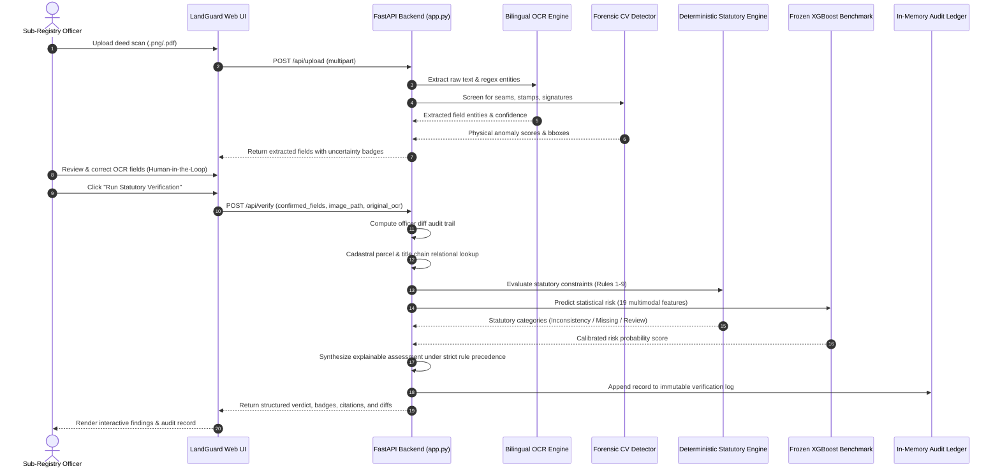

# LandGuard Main Application Integration Handoff Guide

> [!IMPORTANT]
> **AI/Data Freeze & Hand-off Status**:
> The LandGuard AI, synthetic dataset, computer-vision forensics, bilingual OCR, and deterministic rule engine foundations are fully audited, hardened, and frozen.
> This document specifies the exact architecture, serialized artifacts, API contracts, and command-line entry points for developers building downstream interfaces or production deployments.

---

## 1. Architecture & Verification Flow



---

## 2. Frozen Artifact Inventory & Checksums

All models, datasets, and configurations are frozen and verified with SHA-256 digests:

| Component | File Path | Format | SHA-256 Digest (Truncated) |
| :--- | :--- | :---: | :--- |
| **Canonical Dataset** | [`data/full/records/canonical_records.json`](file:///F:/land%20gurd/data/full/records/canonical_records.json) | JSON (2,500 recs) | `24b1bee2a3cb27a7...` |
| **Document Annotations** | [`data/full/annotations/canonical_annotations.json`](file:///F:/land%20gurd/data/full/annotations/canonical_annotations.json) | JSON (600 annos) | `7480a7905f013d80...` |
| **Targeted Expansion** | [`data/targeted_expansion/records/targeted_records.json`](file:///F:/land%20gurd/data/targeted_expansion/records/targeted_records.json) | JSON (100 recs) | `e2a05d6cb90d1655...` |
| **Frozen Risk Model** | [`models/xgboost_risk_model.joblib`](file:///F:/land%20gurd/models/xgboost_risk_model.joblib) | Joblib (Zlib-3) | `af74a704ca2e7d9fb9b6bc0bd0731b4cc504a464f32d8c5f219adb878b506d95` |
| **Model Metadata** | [`models/model_metadata.json`](file:///F:/land%20gurd/models/model_metadata.json) | JSON descriptor | Complete lineage, hyperparams, metrics |

---

## 3. Quickstart CLI Commands

### 3.1 Start Web Demonstration Server
Starts the local single-page demonstration interface on port 8000:
```bash
python scripts/run_app.py
# Server starts at: http://127.0.0.1:8000
```

### 3.2 Execute Full Test Suite
Runs all 52 unit and integration tests across data, models, OCR, vision, and web endpoints:
```bash
python -m pytest -v
# Output: 52 passed in ~2.8s
```

### 3.3 Validate Dataset Integrity & Checksums
Validates all 600 images for watermark text and SHA-256 integrity:
```bash
python scripts/validate_all.py
# Output: 600 checked, 0 mismatches, 0 missing watermarks (Exit code 0)
```

### 3.4 Execute End-to-End Demonstration Script
Executes all 6 curated demonstration scenarios via Python:
```bash
python scripts/demo_end_to_end.py
# Output: 6/6 demo cases passed (Exit code 0)
```

### 3.5 Re-Train & Freeze Risk Model Artifact
Re-trains XGBoost benchmark and freezes weights to `models/`:
```bash
python scripts/train_and_freeze_model.py
```

### 3.6 Run Master Audit Suite
```bash
python scripts/audit_dataset_and_leakage.py
python scripts/audit_ocr_robustness.py
python scripts/audit_cv_robustness.py
python scripts/audit_rule_engine_and_multimodal.py
python scripts/audit_stress_tests.py
```

---

## 4. API Endpoints & Request/Response Specification

| Endpoint | Method | Input | Output | Notes |
| :--- | :---: | :--- | :--- | :--- |
| `/api/health` | `GET` | None | Service status & model readiness | Fast health check |
| `/api/samples` | `GET` | None | List of 6 curated demo cases | Instant UI populator |
| `/api/upload` | `POST` | Multipart file (`.png`, `.jpg`, `.pdf`) | Extracted fields & CV scores | Validates file size & format |
| `/api/verify` | `POST` | JSON `VerifyRequest` | Statutory assessment, diffs, audit | Fast (< 50ms) adjudication |
| `/api/history` | `GET` | None | Reverse-chronological audit log | Immutable session ledger |

For complete request/response JSON schemas, field data types, and error codes, consult [`reports/master_audit/INFERENCE_AND_WEB_CONTRACT.md`](file:///F:/land%20gurd/reports/master_audit/INFERENCE_AND_WEB_CONTRACT.md).

---

## 5. UI Integration Guidelines for Frontend Engineers

1. **Synthetic Demo Banner**:
   All UI pages and PDF printouts MUST prominently display:
   `SYNTHETIC DEMO — NOT AN OFFICIAL DOCUMENT`
2. **Confidence Level Badging**:
   - `VERIFIED_OCR` (Confidence $\ge 0.85$): Green border / pill (`text-green-400`).
   - `MODERATE_CONFIDENCE` (Confidence $0.60 - 0.84$): Blue border / pill (`text-blue-400`).
   - `LOW_CONFIDENCE` (Confidence $< 0.60$): Amber border / pill (`text-amber-400`).
3. **Statutory Status Badging**:
   - `CONFIRMED_INCONSISTENCY`: Red badge (`bg-red-600`), alerts user to hold transaction.
   - `MISSING_EVIDENCE`: Amber badge (`bg-amber-600`), alerts user to request missing archives.
   - `REVIEW_REQUIRED`: Blue badge (`bg-blue-600`), alerts user to conduct AC (Land) hearing.
   - `RISK_INDICATOR`: Purple badge (`bg-purple-600`), recommends secondary screening.
   - `CLEAR_FOR_STANDARD_PROCESSING`: Green badge (`bg-emerald-600`), permits standard conveyance.
4. **Human-in-the-Loop Audit Trail**:
   Always pass `original_ocr_fields` alongside `confirmed_fields` to `/api/verify` so that the backend logs officer edits for administrative accountability.
